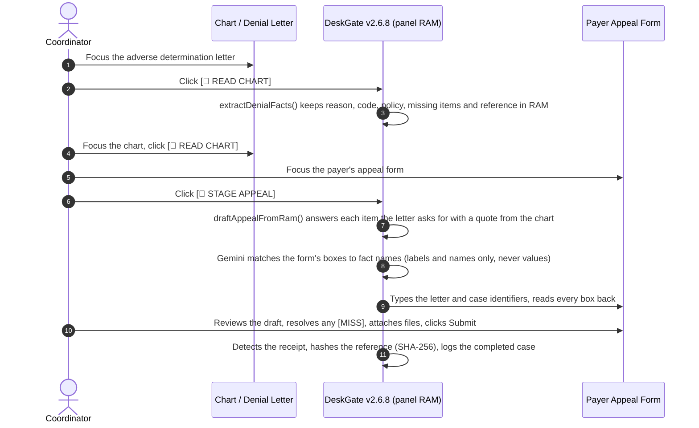

# DeskGate Operator Extension — v2.6.8 (Client Runtime)

> **Auto-drafted appeals. Human Submit.**
> DeskGate drafts the appeal from quoted chart facts and stages it on the payer's own portal form. The coordinator reviews it and presses Submit.

[](https://developer.chrome.com/docs/extensions/mv3/intro/)
[](https://deskgate.app)
[](https://deskgate.app/readiness)
[](LICENSE)
[-purple.svg)](https://deskgate.app/master-terms)

DeskGate is a client-side runtime for **adverse determination appeals**, denial rebuttals and residual prior authorization (PA).

This repository contains the **operator extension** for Chrome and Edge. It runs inside the coordinator's own logged-in browser session, on any payer portal (Availity, CoverMyMeds, UnitedHealthcare, state Medicaid portals and others). It reads the chart and the denial letter, drafts the appeal from quoted facts, types it into the portal form, and stops. Submit stays with the coordinator.

The same engine handles **dental claim appeals**: it quotes probing depths, bone loss, the periodontal diagnosis and the teeth treated from the dental chart. Three synthetic dental tests show it end to end.

**First 10 desks: 30 days free.** See [deskgate.app](https://deskgate.app/#free-month).

---

## 🎯 Why This Exists: The CMS-0057-F & Denial Gap

Federal rule **CMS-0057-F** requires Medicare Advantage, Medicaid, CHIP and federal-exchange plans to offer a FHIR Prior Authorization API from **January 1, 2027**. That moves part of prior authorization off the portal. It leaves the rest where it is:

1. **Commercial employer plans**, including self-funded ERISA plans that cover most insured US workers, are outside the rule.
2. **Pharmacy drug prior auths** (GLP-1s, biologics) are excluded from the API provisions.
3. **Pended cases** still need chart notes and attachments assembled by hand when a request goes to clinical review.
4. **Appeals are not covered at all.** When a payer denies, the rebuttal still goes through the portal or by fax.

```mermaid
flowchart LR
Req["Prior Authorization Request"] --> Rule{"Covered by CMS-0057-F?"}

Rule -- "Yes: MA, Medicaid, CHIP, exchange plans" --> API["2027 FHIR API"]
API --> Rev{"Pended / Denied?"}
Rev -- "Approved" --> Done["Decision"]
Rev -- "Pended or Denied" --> Resid

Rule -- "No: commercial employer plans<br/>and pharmacy drugs" --> Resid["Portal work<br/>(Availity, CoverMyMeds, UHC, state Medicaid)"]

subgraph DG["DeskGate Operator Runtime"]
Appeal["1. Quoted appeal (📝 STAGE APPEAL)"]
Stage["2. Prior-auth form (⚡ STAGE PORTAL)"]
Gate["3. Human Submit"]
Ledger["4. Schedule M ledger (hashes only)"]

Appeal --> Gate
Stage --> Gate
Gate --> Ledger
end

Resid --> Appeal
Resid --> Stage

style Req fill:#0f172a,stroke:#38bdf8,stroke-width:1px,color:#f8fafc
style Rule fill:#0f172a,stroke:#38bdf8,stroke-width:1.5px,color:#f8fafc
style API fill:#0f172a,stroke:#475569,stroke-width:1px,color:#f8fafc
style Rev fill:#0f172a,stroke:#475569,stroke-width:1px,color:#f8fafc
style Done fill:#0f172a,stroke:#475569,stroke-width:1px,color:#f8fafc
style Resid fill:#451a03,stroke:#f59e0b,stroke-width:1.5px,color:#fef3c7
style Stage fill:#083344,stroke:#00e5ff,stroke-width:1.5px,color:#e0f2fe
style Appeal fill:#3b0764,stroke:#c084fc,stroke-width:1.5px,color:#f5d0fe
style Gate fill:#1e1b4b,stroke:#a855f7,stroke-width:2px,color:#f5d0fe
style Ledger fill:#064e3b,stroke:#00ff41,stroke-width:1.5px,color:#dcfce7
style DG fill:#020617,stroke:#00e5ff,stroke-width:1.5px,color:#38bdf8
```



---

## ⚡ Quoted Denial & Reconsideration Engine

Most denials are never appealed because nobody has time to write the rebuttal. When a payer issues an adverse determination (for example *"insufficient duration of conservative therapy"* or *"failed trial dates missing"*), a general-purpose model asked to write the appeal can invent medical necessity or policy citations. DeskGate does not let a model write clinical claims.

**STAGE APPEAL** builds the letter only from facts already read into the panel:



Invariants:

- **No invented clinical facts.** The letter quotes dates, doses and trial outcomes from the chart in RAM. Nothing else.
- **Explicit `[MISS]`.** If the letter asks for something the chart does not show, the draft says `[MISS — … Do not attest.]` instead of inventing it.
- **Administrative boundary.** DeskGate assembles the paperwork. The coordinator checks it and decides to file.

---

## 🧠 How a Form Gets Filled

When the coordinator presses STAGE, DeskGate lists every box on the form, including boxes inside embedded frames (Availity renders its workbench in an iframe). It sends Gemini on Vertex AI the box labels and the **names** of the facts in RAM, and Gemini answers which fact belongs in which box. **Gemini never sees the patient values in this step**: DeskGate types them from RAM and reads every box back.

A portal Gemini has never seen fills the same way, so no portal needs its own script. `lanes.js` is the backup: its word lists are used only when Vertex does not answer within 15 seconds, and they act as a second opinion. When Gemini and the word list read a box differently, the panel says so before Submit.

After typing, the panel reports anything the portal refused (for example a date picker that rejects a format) or reformatted, so the coordinator checks those boxes on screen.

---

## 🛡️ Core Operational & Diligence Invariants

### 1. What leaves the browser

- **Screen reads.** READ CHART captures one frame of the chart or letter. It goes from the panel through `deskgate.app` to Vertex AI in the project `deskgate-production`, covered by the Google Cloud HIPAA BAA executed on 28 Sep 2026. The frame is kept only in the side panel's RAM in the browser. `deskgate.app` passes it on to Vertex AI and stores nothing: no disk, no database, no logs. The facts read from it stay in the panel's RAM until the case ends.
- **Form matching.** `/api/map-fields` receives box labels and fact names only, never patient values.
- **The ledger.** GATE sends one row per case: desk, portal host, flags and a browser-side SHA-256 hash of the payer reference. No names, member IDs, dates of birth, chart text or raw references.
- **Volatile RAM / Zero-Retention Mode (ZRM).** Case facts live in the side panel's memory and are dropped when the panel closes or a new case starts. With ZRM on (Enterprise Plan + executed BAA + volatile RAM), API keys are purged from `chrome.storage.local` and held in session memory only.
- **Model training.** Under Google Cloud's terms, customer data is not used to train models.

### 2. The Non-Negotiable Human Gate

DeskGate types into empty boxes (and replaces only its own unedited `[MISS]` text), then stops. It never clicks anything on the portal: `isIrreversibleControl()` refuses any control that looks like Submit, File, Affirm or Send, and file-upload boxes are never touched. The coordinator reviews the staged form, attaches the files the portal asks for, and clicks Submit. DeskGate has no path to Submit.

### 3. Pilot Ops (optional)

The **PILOT OPS** drawer in the panel holds a charter, a 12-point readiness checklist and the scope boundary for annual contracts that want a frozen-cohort measurement. The free month needs none of it.

---

## 💻 Installation and Quickstart

Production floors should **not** use Developer mode. Force-install the signed CRX.

### Prerequisites

- Google Chrome or Microsoft Edge (Manifest v3, v116+)
- For a locked floor: Intune / Google Admin / GPO so Developer mode stays off

### 1. Production install (no Developer mode)

Extension ID (stable across 2.6.4 → 2.6.8; same packing key):

```
bdhbnbpkkcageebgfabcecolflgembfe
```

1. Host `deskgate-operator-2.6.8.crx` and `updates.xml` on HTTPS (`https://deskgate.app/ext/`).
2. Push one force-install line:

```
bdhbnbpkkcageebgfabcecolflgembfe;https://deskgate.app/ext/updates.xml
```

3. Leave Developer mode **off**. Coordinators pin the action and open CONFIG.

Full Intune / Edge / Chrome policy steps: [`IT_FORCE_INSTALL.md`](IT_FORCE_INSTALL.md).

### 2. Fallback — Developer mode (unmanaged pilot seats only)

1. Clone or download this repository:

```bash
git clone https://github.com/deskgate-app/deskgate-operator-2.6.8-public.git
```

*(Or click **Code** → **Download ZIP** and extract it.)*

2. In Chrome, open `chrome://extensions`.
3. Turn on **Developer mode** (top right).
4. Click **Load unpacked** and select the repository folder (the one that holds `manifest.json`).
5. On the extension's details card, turn on **Allow access to file URLs** (needed for the showcase pages).

Do not use this path for a 200-seat rollout.

### 3. Configuration (30 seconds)

1. Click the DeskGate toolbar icon to open the side panel.
2. Click **CONFIG**:
   - **Backend Host URL**: `https://deskgate.app`.
   - **Desk key**: the key DeskGate issued to your desk from its license list. It names the desk and the sites it works on (its payer portals and its chart system). The panel shows both, refuses to read or stage on any other site, and sends every screen read to Vertex AI in `deskgate-production`, whatever engine is selected. Rows on `/pilot` are filed under the desk the key names.
   - Internal runs without a desk key: enter a **Desk code** (default `DG-INTERNAL`) and choose an engine. Anthropic and xAI are for synthetic pages only.
   - Optional: tick the three **HIPAA / ZRM** boxes to keep keys in volatile RAM.
   - Switzerland: Schweiz-Modus starts switched on so patient data stays in the browser. READ CHART then reads the page text only and STAGE matches boxes with the word list; no frame is captured and `/api/map-fields` is not called. PDFs and Citrix screens without selectable page text are entered by hand in this mode (Bildschirmlesung is disabled in Schweiz-Modus under Schedule CH v2.2 until direct Zürich `europe-west6` routing is enabled). The four demo buttons below it open the Swiss showcase pages on the Backend Host.
3. Click **Save Configuration**.

---

## 🔬 Showcase Suite (12 tests + 3 dental tests + 3 Swiss tests)

The `showcase/` folder runs the whole operator loop with synthetic patients and no payer login. Every page shows a strip at the top (TEST 01 OF 12, what it shows, what to watch). Run them in order; step-by-step notes are in [`SIMULATION_WALKTHROUGH.md`](SIMULATION_WALKTHROUGH.md).

| Test | Open | Press | What to watch |
| :--- | :--- | :--- | :--- |
| 01 | `showcase-chart.html` | READ CHART | Patient, trials, codes and attachment names go into the panel. |
| 02 | `showcase-portal.html` | STAGE PORTAL | Every box fills from the chart. The coordinator clicks Submit; the receipt is logged. |
| 03 | `showcase-portal-iframe.html` | STAGE PORTAL | The boxes inside the frame fill. The decoy Billing Tax ID box stays empty. |
| 04 | `showcase-portal-upload.html` | STAGE PORTAL | DeskGate names the empty upload box and the files to attach. It never attaches files. |
| 05 | `showcase-portal-upload-iframe.html` | STAGE PORTAL | The same upload warning, for a form inside a frame. |
| 06 | `showcase-denial.html` | READ CHART | The letter's facts are kept apart from the chart's facts. |
| 07 | `showcase-denial.pdf` | READ CHART | Only the screen read can see a PDF, and DeskGate says so. |
| 08 | `showcase-letter-pdf-frame.html` | READ CHART | DeskGate spots the PDF inside the page. |
| 09 | `showcase-appeal.html` | STAGE APPEAL | Reference, quoted denial reason, appeal letter and attachments all fill. |
| 10 | `showcase-appeal-rich.html` | STAGE APPEAL | The letter goes into a rich-text editor as a real edit, so the page accepts Submit. |
| 11 | `showcase-appeal-iframe.html` | STAGE APPEAL | Rich-text editor inside a frame: the letter lands and the receipt is logged. |
| 12 | `showcase-appeal-shell.html` | STAGE APPEAL | The portal's own search, lookup and notes boxes stay empty. Everything lands in the form. |

**Dental (3 tests).** The strip reads DENTAL TEST 1 OF 3, and so on. Run them after the medical tests, or on their own after **NEW CASE**.

| Test | Open | Press | What to watch |
| :--- | :--- | :--- | :--- |
| D1 | `showcase-dental-chart.html` | READ CHART | Patient, CDT code with units, teeth treated, probing depths by tooth, bone loss, diagnosis and X-ray file names go into the panel. |
| D2 | `showcase-dental-denial.html` | READ CHART | Claim reference, denial code, policy and the four requested items are read into the letter namespace. |
| D3 | `showcase-dental-appeal.html` | STAGE APPEAL | Claim reference, CDT codes, teeth and the quoted denial reason fill. The appeal answers all four requests with quotes from the chart. The X-ray upload box is named, never filled: attach `SYN_FMX_radiographs_0820.pdf` and `SYN_perio_chart_0820.pdf` from the showcase folder yourself, then Submit. |

**Switzerland (3 tests, TARDOC 2026).** The strip reads SCHWEIZ TEST 1 VON 3, and so on. Press **NEW CASE** first, or open the pages with the demo buttons in CONFIG (button 1 starts a new case). The tests run the same with Schweiz-Modus on or off. The patient, the practice, the lab, the podology practice and the insurer (AlpaCare Krankenversicherung AG, BAG-Nr. 00999) are invented; GLN, AHV-Nr. and ZSR are synthetic numbers with valid check digits.

| Test | Open | Press | What to watch |
| :--- | :--- | :--- | :--- |
| S1 | `swiss-chart-denial.html#kg` | READ CHART | Patient, AHV-Nr., Versicherten-Nr., card number, GLN, ZSR, `tardoc: CA.00.0010 x1, CA.00.0020 x15, CA.00.0030 x18`, 38 minutes, the KG lines (`KG 1` to `KG 7`) and the names of the four documents on the chart (`attachments`) go into the panel. |
| S2 | same page, tab **Eingang: Antwort AlpaCare** (`#kuerzung`) | READ CHART | Leistungsabrechnung AC-LA-2026-0731184, Bemerkungscode, `tardoc_disputed: CA.00.0030 x18`, Kürzungsgrund and the four requested items go into the letter namespace. Chart facts untouched. |
| S3 | `swiss-appeal-portal.html` | STAGE APPEAL | 18 boxes fill, the date picker gets 15.09.2026, the birth date stays 07.03.1961. The German Stellungnahme answers three items with KG quotes and marks the photo documentation `[FEHLT]` (none of the four documents is a photo). It lists the four PDFs as Beilagen, and their names go into the Beilagen box. The upload box is never touched: attach the PDFs from the showcase folder yourself if you want them on the receipt. The search box stays empty. The three WZW boxes and the Vertrauensarzt box stay empty: the page refuses Submit until a person ticks WZW. |

**Swiss documents.** The chart's Dokumente list names four one-page synthetic PDFs. They are not tests (no strip, nothing to press); they are the practice's paperwork for the case, and every value in them matches the chart.

| File | What it is | Ties to the chart |
| :--- | :--- | :--- |
| `KG_Auszug_2026-09-15.pdf` | Auszug aus der Krankengeschichte, Konsultation vom 15.09.2026 | Built from the chart's KG entry word for word: the same lines, TARDOC rows, visa and Rechnungs-Nr. 2026-004517. It holds what AlpaCare asks for in items 1–3. |
| `Labor_HbA1c_2026-09-02.pdf` | Laborbefund from Muster-Labor Zürich AG | HbA1c 8.4 % (68 mmol/mol) on 02.09.2026, as quoted in the Anamnese. |
| `Verordnung_Entlastungsschuh_2026-09-15.pdf` | Ärztliche Verordnung, Vorfussentlastungsschuh rechts | The «Entlastungsschuh verordnet» in the Procedere. |
| `Zuweisung_Podologie_2026-09-15.pdf` | Podology prescription under Art. 11c KLV (category A, valid to 31.12.2026) | The «Zuweisung an Podologie» in the Procedere. |

`schweiz-compliance.html` is not a test: it is the customer-facing page on data protection for Swiss practices (Schweiz-Modus, the screen-read option, what is stored, the 30-day test).

The three `-form.html` pages and the denial PDF are loaded inside other tests; keep all 28 files together (the two `SYN_*.pdf` files are synthetic attachments for test D3, and the four Swiss PDFs are the documents on the S1 chart). Showcase rows post to the ledger as `<desk code>-SYN` and never count as desk results.

---

## 🔒 What a Security or Compliance Reviewer Should Inspect

| Verification Area | Implementation |
| :--- | :--- |
| Workstation storage | `saveKey()` and `purgePhiFromDisk()` in `sidepanel.js`. Turning on ZRM moves keys from `chrome.storage.local` into volatile RAM. |
| Screen capture scope | `captureDisplayGlassBase64()` in `sidepanel.js`. `getDisplayMedia` shows the OS picker, captures one frame and stops the tracks at once. |
| Form matching | `aiFieldMap()` in `sidepanel.js`. Sends box labels and fact names to `/api/map-fields`; values stay in RAM. |
| Human gate | `isIrreversibleControl()` in `content.js`. Submit / File / Affirm / button controls are refused; the field inventory excludes submit, button and file inputs. |
| Ledger sanitisation | `postPilotEvent()` in `sidepanel.js`. Payer references are SHA-256 hashed in the browser before `/api/pilot-event`. Raw references, names and notes are not sent. |
| Appeal integrity | `draftAppealFromRam()` in `lanes.js`. Quotes RAM only. Missing keys stay `[MISS]`. Each requested item, medical or dental, is answered in `evaluateRequestedItem()` with a quoted chart line or a `[MISS]`. |

---

## 📊 Measurement (Schedule M ledger)

- **Headline:** completed cases per coordinator-day against the desk's own count from before DeskGate.
- **Completed case:** a human Submit on the portal paired with the payer's reference (stored as a hash).
- **Gate-accept:** how often the coordinator submitted what DeskGate staged.
- **Material edit:** how often the coordinator had to change a box DeskGate filled.
- **Autonomous Submit:** always 0.

No savings are claimed until a desk's ledger exists.

---

## 🏛️ Issuer and Corporate Governance

- **Entity:** DeskGate, Inc. (Delaware C-Corporation)
- **Founders:** Hans Johannes Schulte (Systems & Product Architect) & Jolanda C. M. Wevers Schulte (Operations & Governance)
- **Address:** 131 Continental Dr, Suite 305, Newark, DE 19713, United States
- **Contact:** [hans@deskgate.app](mailto:hans@deskgate.app) · +1 (302) 244-7953
- **License:** The client extension code in this repository is licensed under the [MIT License](LICENSE). The hosted APIs at https://deskgate.app, trademarks, desk licensing and Business Associate obligations are not covered by MIT. See [`NOTICE`](NOTICE) and the [Master Terms](https://deskgate.app/master-terms).
